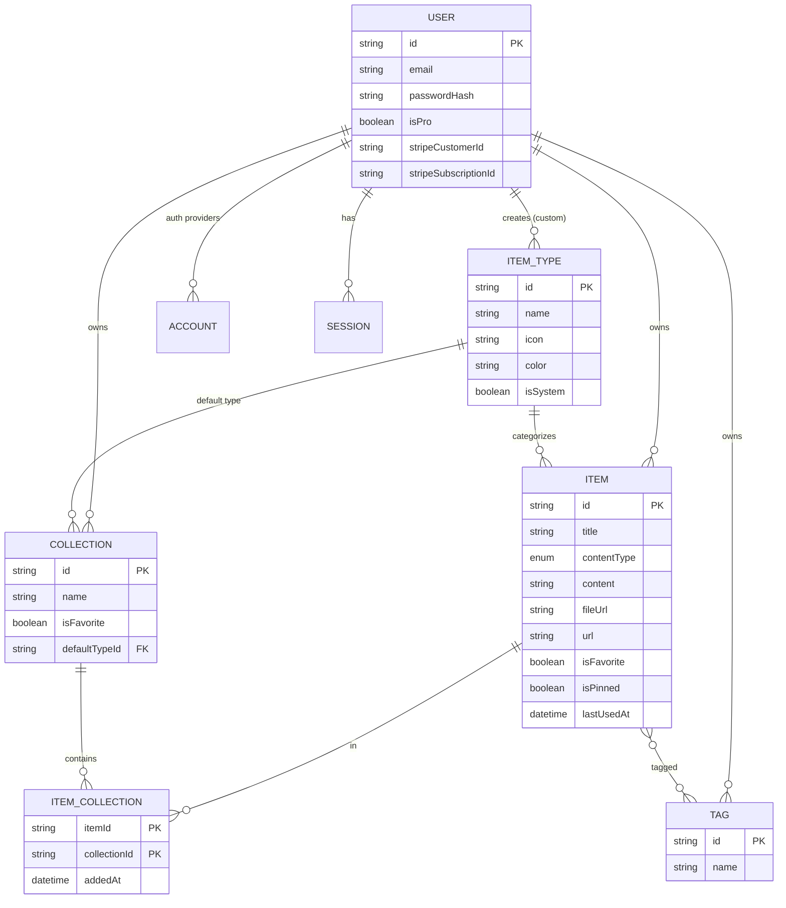
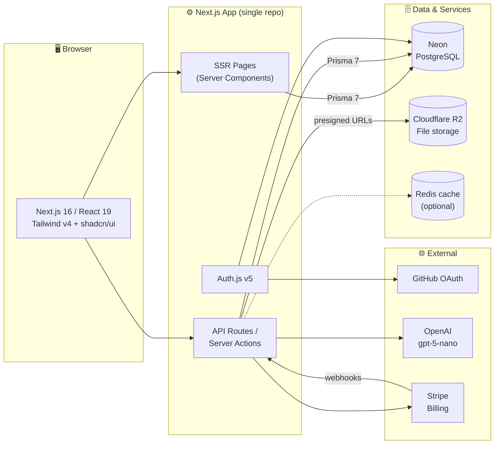
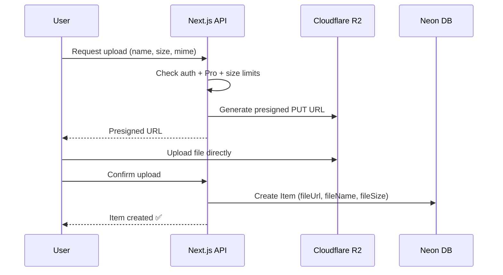

# 🧠 DevLore — Project Overview

> **One fast, searchable, AI-enhanced hub for all your developer knowledge.**
> Snippets, prompts, commands, notes, files, images and links, all in one place.

---

## 📑 Table of Contents

1. [Problem](#-problem)
2. [Target Users](#-target-users)
3. [Features](#-features)
4. [Data Model](#-data-model)
5. [Prisma Schema](#-prisma-schema)
6. [Architecture](#-architecture)
7. [Tech Stack](#-tech-stack)
8. [Monetization](#-monetization)
9. [UI / UX](#-ui--ux)
10. [Routes](#-routes)
11. [Open Questions & Decisions](#-open-questions--decisions)
12. [Reference Links](#-reference-links)

---

## 🔥 Problem

Developers keep their essentials scattered across many tools:

| What              | Where it usually lives |
| ----------------- | ---------------------- |
| Code snippets     | VS Code, Notion        |
| AI prompts        | Old chat threads       |
| Context files     | Buried inside projects |
| Useful links      | Browser bookmarks      |
| Docs              | Random folders         |
| Commands          | `.txt` files           |
| Project templates | GitHub Gists           |
| Terminal commands | Bash history           |

The result is **context switching, lost knowledge and inconsistent workflows**.

**DevLore** fixes this with a single, fast, searchable, AI-enhanced hub for dev knowledge and resources.

---

## 👥 Target Users

| Persona                           | Primary need                                          |
| --------------------------------- | ----------------------------------------------------- |
| 🧑‍💻 **Everyday Developer**         | Grab snippets, prompts, commands and links fast       |
| 🤖 **AI-first Developer**         | Save prompts, contexts, workflows and system messages |
| 🎓 **Content Creator / Educator** | Store code blocks, explanations and course notes      |
| 🏗️ **Full-stack Builder**         | Collect patterns, boilerplates and API examples       |

---

## ✨ Features

### A. Items & Item Types

Every item has a **type**. DevLore ships with seven **system types** that can't be edited or deleted. Users will be able to create **custom types** later (Pro).

| Type    | Content kind | Icon (Lucide) | Color                | Plan |
| ------- | ------------ | ------------- | -------------------- | ---- |
| Snippet | Text         | `Code`        | `#3b82f6` 🔵 blue    | Free |
| Prompt  | Text         | `Sparkles`    | `#8b5cf6` 🟣 purple  | Free |
| Note    | Text         | `StickyNote`  | `#fde047` 🟡 yellow  | Free |
| Command | Text         | `Terminal`    | `#f97316` 🟠 orange  | Free |
| Link    | URL          | `Link`        | `#10b981` 🟢 emerald | Free |
| File    | File         | `File`        | `#6b7280` ⚪ gray    | Pro  |
| Image   | File         | `Image`       | `#ec4899` 🩷 pink    | Pro  |

- Item list URLs are pluralized by type: `/items/snippets`, `/items/prompts`, `/items/links`, etc.
- Items are created and opened in a **quick-access drawer**, not a separate page.

### B. Collections

- A collection can hold items of **any type**.
- An item can belong to **multiple collections** (many-to-many). For example, a React snippet can live in both _React Patterns_ and _Interview Prep_.
- Example collections:
  - **React Patterns**: snippets, notes
  - **Context Files**: files
  - **Python Snippets**: snippets

### C. Search

Search across:

- Content
- Tags
- Titles
- Types

> 💡 Start with Postgres full-text search (`tsvector` + GIN index). Consider `pg_trgm` for fuzzy title matching. Both are supported on Neon.

### D. Authentication

- Email + password
- GitHub OAuth

### E. Core Features

- ⭐ Favorite collections and items
- 📌 Pin items to the top
- 🕒 Recently used items
- 📥 Import code from a file
- 📝 Markdown editor for text types
- 📎 File upload for file types (file / image)
- 📤 Export data in different formats (JSON / ZIP)
- 🌙 Dark mode by default
- 🗂️ Add/remove an item to/from multiple collections
- 🔍 See which collections an item belongs to

### F. AI Features (Pro)

| Feature              | Description                                       |
| -------------------- | ------------------------------------------------- |
| 🏷️ Auto-tagging      | Suggest tags based on item content                |
| 📄 Summaries         | Generate short summaries of notes, files, prompts |
| 💬 Explain This Code | Plain-English explanation of a snippet            |
| ⚡ Prompt Optimizer  | Rewrite prompts to be clearer and more effective  |

---

## 🗃️ Data Model

> Rough model, not set in stone. Cleaned up from the original notes. See [Open Questions](#-open-questions--decisions) for changes made.

### Entity Relationships



---

## 🧬 Prisma Schema

Targets **Prisma 7**. Includes the Auth.js (NextAuth v5) adapter models.

> ⚠️ **Never use `prisma db push`** or change the database structure directly. All schema changes go through migrations:
>
> ```bash
> # Development: create and apply a migration
> npx prisma migrate dev --name <descriptive_name>
>
> # Production: apply pending migrations
> npx prisma migrate deploy
> ```

```prisma
// prisma/schema.prisma

generator client {
  provider = "prisma-client"
  output   = "../src/generated/prisma"
}

datasource db {
  provider = "postgresql"
  // Prisma 7: connection URL lives in prisma.config.ts
}

// ─────────────────────────────────────────────
// Auth (Auth.js / NextAuth v5 adapter models)
// ─────────────────────────────────────────────

model User {
  id                   String    @id @default(cuid())
  name                 String?
  email                String    @unique
  emailVerified        DateTime?
  image                String?
  passwordHash         String?   // null for OAuth-only users

  // Billing
  isPro                Boolean   @default(false)
  stripeCustomerId     String?   @unique
  stripeSubscriptionId String?   @unique

  accounts    Account[]
  sessions    Session[]
  items       Item[]
  itemTypes   ItemType[]
  collections Collection[]
  tags        Tag[]

  createdAt DateTime @default(now())
  updatedAt DateTime @updatedAt
}

model Account {
  userId            String
  type              String
  provider          String
  providerAccountId String
  refresh_token     String?
  access_token      String?
  expires_at        Int?
  token_type        String?
  scope             String?
  id_token          String?
  session_state     String?

  user User @relation(fields: [userId], references: [id], onDelete: Cascade)

  createdAt DateTime @default(now())
  updatedAt DateTime @updatedAt

  @@id([provider, providerAccountId])
}

model Session {
  sessionToken String   @unique
  userId       String
  expires      DateTime
  user         User     @relation(fields: [userId], references: [id], onDelete: Cascade)

  createdAt DateTime @default(now())
  updatedAt DateTime @updatedAt
}

model VerificationToken {
  identifier String
  token      String
  expires    DateTime

  @@id([identifier, token])
}

// ─────────────────────────────────────────────
// App models
// ─────────────────────────────────────────────

enum ContentType {
  TEXT
  FILE
  URL
}

model ItemType {
  id          String      @id @default(cuid())
  name        String      // "snippet", "prompt", ...
  slug        String      // "snippets" -> used in /items/[slug]
  icon        String      // Lucide icon name, e.g. "Code"
  color       String      // hex, e.g. "#3b82f6"
  contentType ContentType
  isSystem    Boolean     @default(false)
  isProOnly   Boolean     @default(false)

  userId String? // null for system types
  user   User?   @relation(fields: [userId], references: [id], onDelete: Cascade)

  items              Item[]
  defaultCollections Collection[]

  createdAt DateTime @default(now())
  updatedAt DateTime @updatedAt

  @@unique([userId, slug])
}

model Item {
  id          String      @id @default(cuid())
  title       String
  description String?
  contentType ContentType

  // TEXT
  content  String?  @db.Text
  language String?  // optional, for code highlighting

  // FILE (Cloudflare R2)
  fileUrl  String?
  fileName String?
  fileSize Int?     // bytes
  mimeType String?

  // URL
  url String?

  isFavorite Boolean   @default(false)
  isPinned   Boolean   @default(false)
  lastUsedAt DateTime? // powers "Recently used"

  userId String
  user   User   @relation(fields: [userId], references: [id], onDelete: Cascade)

  typeId String
  type   ItemType @relation(fields: [typeId], references: [id])

  tags        Tag[]            // implicit many-to-many
  collections ItemCollection[]

  createdAt DateTime @default(now())
  updatedAt DateTime @updatedAt

  @@index([userId, typeId])
  @@index([userId, isPinned])
  @@index([userId, lastUsedAt])
}

model Collection {
  id          String  @id @default(cuid())
  name        String
  description String?
  isFavorite  Boolean @default(false)

  // Type used for styling / new items when the collection is empty
  defaultTypeId String?
  defaultType   ItemType? @relation(fields: [defaultTypeId], references: [id])

  userId String
  user   User   @relation(fields: [userId], references: [id], onDelete: Cascade)

  items ItemCollection[]

  createdAt DateTime @default(now())
  updatedAt DateTime @updatedAt

  @@index([userId])
}

model ItemCollection {
  itemId       String
  collectionId String
  addedAt      DateTime @default(now())

  item       Item       @relation(fields: [itemId], references: [id], onDelete: Cascade)
  collection Collection @relation(fields: [collectionId], references: [id], onDelete: Cascade)

  @@id([itemId, collectionId])
  @@index([collectionId])
}

model Tag {
  id   String @id @default(cuid())
  name String

  userId String
  user   User   @relation(fields: [userId], references: [id], onDelete: Cascade)

  items Item[]

  @@unique([userId, name])
}
```

```ts
// prisma.config.ts
import "dotenv/config";
import { defineConfig, env } from "prisma/config";

export default defineConfig({
  schema: "prisma/schema.prisma",
  migrations: { path: "prisma/migrations" },
  datasource: { url: env("DATABASE_URL") },
});
```

### System Type Seed

```ts
// prisma/seed.ts (excerpt)
const systemTypes = [
  {
    name: "snippet",
    slug: "snippets",
    icon: "Code",
    color: "#3b82f6",
    contentType: "TEXT",
    isProOnly: false,
  },
  {
    name: "prompt",
    slug: "prompts",
    icon: "Sparkles",
    color: "#8b5cf6",
    contentType: "TEXT",
    isProOnly: false,
  },
  {
    name: "note",
    slug: "notes",
    icon: "StickyNote",
    color: "#fde047",
    contentType: "TEXT",
    isProOnly: false,
  },
  {
    name: "command",
    slug: "commands",
    icon: "Terminal",
    color: "#f97316",
    contentType: "TEXT",
    isProOnly: false,
  },
  {
    name: "link",
    slug: "links",
    icon: "Link",
    color: "#10b981",
    contentType: "URL",
    isProOnly: false,
  },
  {
    name: "file",
    slug: "files",
    icon: "File",
    color: "#6b7280",
    contentType: "FILE",
    isProOnly: true,
  },
  {
    name: "image",
    slug: "images",
    icon: "Image",
    color: "#ec4899",
    contentType: "FILE",
    isProOnly: true,
  },
] as const;
```

---

## 🏛️ Architecture



### File Upload Flow



---

## 🧰 Tech Stack

| Layer        | Choice                          | Notes                                              |
| ------------ | ------------------------------- | -------------------------------------------------- |
| Framework    | **Next.js 16 / React 19**       | SSR pages + dynamic client components; App Router  |
| Language     | **TypeScript**                  | End-to-end type safety                             |
| Database     | **Neon PostgreSQL**             | Serverless Postgres; branches for dev/preview      |
| ORM          | **Prisma 7**                    | Migrations only, never `db push`                   |
| Cache        | **Redis** _(maybe)_             | e.g. Upstash, if/when needed                       |
| File storage | **Cloudflare R2**               | S3-compatible; presigned uploads                   |
| Auth         | **Auth.js (NextAuth v5)**       | Credentials (email/password) + GitHub OAuth        |
| AI           | **OpenAI `gpt-5-nano`**         | Tags, summaries, explanations, prompt optimization |
| Payments     | **Stripe**                      | Subscriptions + webhooks                           |
| Styling      | **Tailwind CSS v4 + shadcn/ui** | Dark mode default                                  |
| Icons        | **Lucide**                      | Matches shadcn/ui defaults                         |
| Repo         | Single codebase                 | Less overhead                                      |

### Environment Variables

```bash
# Database
DATABASE_URL=

# Auth
AUTH_SECRET=
AUTH_GITHUB_ID=
AUTH_GITHUB_SECRET=

# Cloudflare R2
R2_ACCOUNT_ID=
R2_ACCESS_KEY_ID=
R2_SECRET_ACCESS_KEY=
R2_BUCKET_NAME=
R2_PUBLIC_URL=

# OpenAI
OPENAI_API_KEY=

# Stripe
STRIPE_SECRET_KEY=
STRIPE_WEBHOOK_SECRET=
STRIPE_PRICE_MONTHLY=
STRIPE_PRICE_YEARLY=

# Redis (optional)
REDIS_URL=
```

---

## 💰 Monetization

Freemium model.

| Feature              | Free                    | Pro — $8/mo or $72/yr |
| -------------------- | ----------------------- | --------------------- |
| Items                | 50 total                | Unlimited             |
| Collections          | 3                       | Unlimited             |
| System types         | All except File & Image | All                   |
| File & image uploads | ❌                      | ✅                    |
| Custom types         | ❌                      | ✅ _(coming later)_   |
| Search               | Basic                   | Basic                 |
| AI auto-tagging      | ❌                      | ✅                    |
| AI summaries         | ❌                      | ✅                    |
| AI code explanation  | ❌                      | ✅                    |
| AI prompt optimizer  | ❌                      | ✅                    |
| Export (JSON / ZIP)  | ❌                      | ✅                    |
| Priority support     | ❌                      | ✅                    |

> 🚧 **During development:** build the Pro foundation (`isPro`, limit checks, Stripe fields), but **let all users access everything**. A single feature flag makes this easy to flip later:
>
> ```ts
> // lib/plan.ts
> export const ENFORCE_PLAN_LIMITS = process.env.ENFORCE_PLAN_LIMITS === "true";
>
> export const FREE_LIMITS = { items: 50, collections: 3 } as const;
>
> export function canUsePro(user: { isPro: boolean }) {
>   return !ENFORCE_PLAN_LIMITS || user.isPro;
> }
> ```

---

## 🎨 UI / UX

### Design Principles

- Modern, minimal, developer-focused
- **Dark mode by default**, light mode optional
- Clean typography and generous whitespace
- Subtle borders and shadows
- Syntax highlighting for code blocks
- Inspiration: [Notion](https://www.notion.so), [Linear](https://linear.app), [Raycast](https://www.raycast.com)

### Layout

```
┌────────────────────┬──────────────────────────────────────────────┐
│  DevLore      [≡]  │  🔍 Search…                       [+ New]    │
├────────────────────┼──────────────────────────────────────────────┤
│  TYPES             │  Collections                                 │
│  </> Snippets      │  ┌──────────┐ ┌──────────┐ ┌──────────┐      │
│  ✨  Prompts       │  │ React    │ │ Context  │ │ Python   │      │
│  >_  Commands      │  │ Patterns │ │ Files    │ │ Snippets │      │
│  🗒  Notes         │  │ (blue bg)│ │ (gray bg)│ │ (blue bg)│      │
│  🔗  Links         │  └──────────┘ └──────────┘ └──────────┘      │
│  📄  Files    PRO  │                                              │
│  🖼  Images   PRO  │  Items                                       │
│                    │  ┃ useDebounce hook        (blue border)     │
│  COLLECTIONS       │  ┃ Code review prompt      (purple border)   │
│  ⭐ React Patterns │  ┃ docker compose up -d    (orange border)   │
│     Context Files  │                                              │
│     Python Snippets│                         ┌──────────────────┐ │
│                    │                         │  Item drawer  ⟶  │ │
│  [avatar] Settings │                         └──────────────────┘ │
└────────────────────┴──────────────────────────────────────────────┘
```

- **Sidebar** (collapsible): item types linking to `/items/[type]`, plus latest collections.
- **Main area**: grid of collection cards. Each card's **background color** comes from the type it holds the most of.
- **Items** appear as cards with a **border color** matching their type.
- **Item drawer**: items open in a fast slide-over drawer (shadcn `Sheet`) for viewing and editing.

### Responsive

- Desktop-first, but usable on mobile
- Sidebar becomes a drawer on mobile

### Micro-interactions

- Smooth transitions
- Hover states on cards
- Toast notifications for actions (shadcn `Sonner`)
- Loading skeletons

---

## 🧭 Routes

| Route                     | Description                                     |
| ------------------------- | ----------------------------------------------- |
| `/`                       | Marketing / landing page                        |
| `/sign-in`, `/sign-up`    | Authentication                                  |
| `/dashboard`              | Collections grid + pinned & recent items        |
| `/items/[type]`           | Items filtered by type, e.g. `/items/snippets`  |
| `/collections`            | All collections                                 |
| `/collections/[id]`       | Single collection with its items                |
| `/search?q=`              | Search results                                  |
| `/settings`               | Profile, theme, export                          |
| `/settings/billing`       | Plan & Stripe customer portal                   |
| `/api/auth/[...nextauth]` | Auth.js handlers                                |
| `/api/upload`             | Presigned R2 upload URLs                        |
| `/api/ai/*`               | AI endpoints (tags, summary, explain, optimize) |
| `/api/webhooks/stripe`    | Stripe webhook handler                          |

> Items open in a drawer, so a dedicated item page is optional. Adding `?item=<id>` to the URL keeps drawers shareable and back-button friendly.

---

## ❓ Open Questions & Decisions

### Cleanups made to the original notes

| Original                                  | Change                                         | Why                                        |
| ----------------------------------------- | ---------------------------------------------- | ------------------------------------------ |
| "Here is a list of features for DevStash" | Renamed to **DevLore**                         | Leftover old name                          |
| "GitHu gists"                             | **GitHub Gists**                               | Typo                                       |
| `contentType (text \| file)`              | `TEXT \| FILE \| URL`                          | Links store a URL, not text or a file      |
| `contentType` only on Item                | Also on `ItemType`                             | Type decides which editor/uploader to show |
| No password field                         | Added `User.passwordHash`                      | Needed for email/password sign-in          |
| Tag had only `id`, `name`                 | Added `userId` + unique `[userId, name]`       | Tags shouldn't leak between users          |
| "Recently used" had no backing field      | Added `Item.lastUsedAt`                        | Powers the recent list                     |
| No mime type                              | Added `Item.mimeType`                          | Needed for image preview vs. file download |
| No URL slug on types                      | Added `ItemType.slug` (`snippets`, `links`, …) | Matches `/items/snippets` routing          |
| No Pro flag on types                      | Added `ItemType.isProOnly`                     | File/Image are Pro-only                    |

### Still to decide

- [ ] **Free tier search**: is Pro search different from "basic search," or is it the same for both plans?
- [ ] **AI summaries** appear in the AI feature list but not in the Pro pricing list. Confirm they're Pro.
- [ ] **File limits**: max file size and total storage per Pro user?
- [ ] **Export formats**: JSON and ZIP only, or Markdown too?
- [ ] **Downgrade behavior**: what happens to items over the limit (and uploaded files) when a Pro user cancels?
- [ ] **Redis**: needed at launch, or defer until there's a measured need?
- [ ] **AI rate limits**: per-user daily caps on AI calls to control cost?
- [ ] **Collection color**: computed on the fly (most frequent type) or cached on the collection?
- [ ] **Account linking**: if a user signs up with email, then later with GitHub using the same email, should the accounts link?

---

## 🔗 Reference Links

| Tool               | Docs                                               |
| ------------------ | -------------------------------------------------- |
| Next.js            | https://nextjs.org/docs                            |
| React              | https://react.dev                                  |
| Prisma             | https://www.prisma.io/docs                         |
| Prisma Migrate     | https://www.prisma.io/docs/orm/prisma-migrate      |
| Neon               | https://neon.tech/docs                             |
| Auth.js (NextAuth) | https://authjs.dev                                 |
| Auth.js + Prisma   | https://authjs.dev/getting-started/adapters/prisma |
| Cloudflare R2      | https://developers.cloudflare.com/r2/              |
| OpenAI API         | https://platform.openai.com/docs                   |
| Stripe Billing     | https://docs.stripe.com/billing                    |
| Tailwind CSS       | https://tailwindcss.com/docs                       |
| shadcn/ui          | https://ui.shadcn.com                              |
| Lucide Icons       | https://lucide.dev/icons                           |
| Mermaid (diagrams) | https://mermaid.js.org                             |
