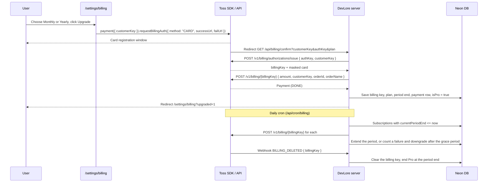

# Toss Payments Integration Plan: DevLore Pro

> Research output for `context/research/tosspay-integration-research.md` (2026-11-10).
> Covers Pro subscriptions at $8/month or $72/year using Toss Payments **자동결제 (billing)**.

---

## 0. Read this first: how Toss differs from Stripe

The research prompt and `.env.example` assume a Stripe-like model (price IDs, hosted checkout, a subscription webhook). Toss Payments billing does not work that way. Four differences shape the rest of this plan:

| Topic | Stripe (what the spec assumed) | Toss Payments billing |
| --- | --- | --- |
| Products and prices | Price objects (`price_…`) in the dashboard | **No price objects.** You send `amount` on every charge, so `TOSS_PRICE_ID_MONTHLY`/`TOSS_PRICE_ID_YEARLY` have nothing to point at |
| Recurring charges | Stripe charges on schedule | **Toss has no scheduler** ("토스페이먼츠에서는 자체적으로 스케줄링 기능을 제공하지 않아요"). DevLore must run a cron job that charges each due subscription |
| Webhooks | `invoice.paid`, `customer.subscription.deleted`, … | **No webhook when a billing charge succeeds** (billing charges are approved synchronously). The only billing event is `BILLING_DELETED` (billing key removed, e.g. by the card company or from the Toss admin) |
| Cards and currency | Global cards, USD | Billing supports **Korean-issued cards only** (no foreign cards or overseas payments). Charges are in **KRW** |

### Decisions needed before implementation

1. **KRW pricing.** $8 and $72 can't be charged as USD. Pick KRW amounts (for example ₩11,000/month and ₩99,000/year; these are placeholders, not a recommendation) and decide whether the homepage shows KRW, USD, or both. `PLAN_PRICES` in `src/lib/homepage.ts` is currently USD-only.
2. **Audience.** With Korean cards only, non-Korean users can't upgrade. If the audience is international, Toss alone won't be enough (Stripe or Paddle for international users, or Toss's PayPal/overseas methods for one-time payments, which don't support billing).
3. **Contract.** Billing needs an extra risk review and contract with Toss ("자동결제는 추가 리스크 검토 및 계약 후 사용할 수 있습니다"). Test keys work without it, but live keys from a MID without a billing contract fail with `NOT_SUPPORTED_METHOD`. Start the contract early, since it can block launch.
4. **What happens on downgrade** (already an open question in the project overview): items over 50, collections over 3 and uploaded files when a Pro user's billing ends.

### What this means for the session note in the research prompt

The note proposes syncing `isPro` from the database in the `jwt` callback because "a Toss Pay webhook updates `isPro`". With Toss, **DevLore's own code** sets `isPro`:

- the billing-key confirm route sets it right after the first charge succeeds,
- the cron job clears it when a renewal fails for good or a cancelled period ends,
- the `BILLING_DELETED` webhook clears or flags it.

The last two happen outside any user request, so the client can't be told directly. **The always-sync approach is still the right call** and is kept in section 2.4. One refinement: server-side gating (limits, uploads, AI) should read the plan from the database (`getUserPlan`) rather than trust `session.user.isPro`, which is for UI only.

---

## 1. Current state analysis

### 1.1 User model (`prisma/schema.prisma`)

```prisma
// Billing
isPro                Boolean @default(false)
stripeCustomerId     String? @unique
stripeSubscriptionId String? @unique
```

- `isPro` exists and defaults to `false`. Nothing reads it yet. The seed sets `isPro: false` for the demo user (`prisma/seed.ts:366`).
- `stripeCustomerId` and `stripeSubscriptionId` are unused. There are **no** `tossCustomerId` or `tossSubscriptionId` fields. Toss has no subscription object anyway; see section 2.1 for the replacement fields.
- Migrations so far: `20261024020606_init` and `20261106224952_add_user_editor_preferences`.

### 1.2 NextAuth (v5 beta)

- `src/auth.config.ts`: edge-safe config with GitHub and a placeholder Credentials provider, `pages.signIn = "/sign-in"`. Imported by `src/proxy.ts`.
- `src/auth.ts`: Prisma adapter, `session: { strategy: "jwt" }`, real bcrypt Credentials provider. The only callback is `session`, which copies `token.sub` to `session.user.id`. **There is no `jwt` callback yet.**
- `src/types/next-auth.d.ts`: extends `Session.user` with `id` only.
- `src/proxy.ts`: protects `/dashboard`, `/profile`, `/items`, `/collections`, `/settings`, `/favorites`. It uses the edge config, so a `jwt` callback in `src/auth.ts` (with Prisma) won't run in the proxy. That's fine, since the proxy only checks that a session exists.

### 1.3 How user data is accessed

- **Server components and pages** call `await connection()` then `const session = await auth()` and redirect to `/sign-in?callbackUrl=…` when there's no `session.user.id` (for example `src/app/settings/page.tsx`).
- **Server actions** (`src/actions/*.ts`) start with:
  ```ts
  const session = await auth();
  if (!session?.user?.id) return { success: false, error: "You must be signed in" };
  ```
  then Zod-validate, call a query in `src/lib/db/*.ts` with `session.user.id`, and return `{ success, data, error }` (plus `fieldErrors` for forms). Errors are caught, logged with `console.error`, and turned into a user-friendly message. Mutations call `refresh()` from `next/cache` on success.
- **DB queries** live in `src/lib/db/*.ts` with `import "server-only"`, always take `userId` and put it in the `where` for ownership. `P2025` maps to `null` via `isPrismaError` (`src/lib/db/prisma-errors.ts`).
- **Client components** get user data as props from server components or through server actions. `useSession()` isn't used anywhere, so there is no `SessionProvider`.

### 1.4 Existing payment code

None. No Stripe or Toss package, route, action or component. Billing-related pieces that do exist:

- `.env.example` (uncommitted change) adds `TOSS_SECRET_KEY`, `TOSS_PUBLISHABLE_KEY`, `TOSS_WEBHOOK_SECRET`, `TOSS_PRICE_ID_MONTHLY`, `TOSS_PRICE_ID_YEARLY`. See section 2.8 for the corrected list.
- `src/lib/homepage.ts`: `PLAN_PRICES = { monthly: 8, yearly: 72 }` (USD), `getProPrice`, `YEARLY_SAVINGS_PERCENT`, `PLANS`, and `getPlanHref(isSignedIn)`, which currently sends signed-in users to `/dashboard` ("billing isn't built yet").
- `src/components/home/PricingToggle.tsx`: monthly/yearly switch on the homepage.
- `ItemType.isProOnly` drives the "PRO" badge in the sidebar (`SidebarNavItem`). It isn't enforced anywhere.

---

## 2. Feature gating analysis

### 2.1 Free limits (from `context/project-overview.md`)

| Limit | Free | Pro |
| --- | --- | --- |
| Items | 50 total | Unlimited |
| Collections | 3 | Unlimited |
| File and Image types | No | Yes |
| AI features, custom types, export | No | Yes (none of these are built yet) |

The spec asks for a flag so that everything stays unlocked during development: `ENFORCE_PLAN_LIMITS`, `FREE_LIMITS` and `canUsePro` in `src/lib/plan.ts`. **That file doesn't exist yet.**

### 2.2 Where limits must be checked

| Check | Where | Notes |
| --- | --- | --- |
| Item count < 50 | `createItem` in `src/actions/items.ts`, after validation and before `createItemQuery` | Use `prisma.item.count({ where: { userId } })`. On failure call `fail(...)` so an uploaded file is removed |
| File/Image type | `createItem` (when `parsed.data.type` is `files` or `images`) **and** `POST /api/upload` before buffering | The upload route is the real gate, since it writes to R2 |
| Collection count < 3 | `createCollection` in `src/actions/collections.ts`, before `createCollectionQuery` | `prisma.collection.count({ where: { userId } })` |
| UI hints | `CreateItemDialog`/`TypeSelector` (disable File/Image with an "Upgrade" hint), `CreateCollectionDialog`, top bar "New" buttons | Hints only; the server checks above are what count |
| Future Pro features | AI routes (`/api/ai/*`), export, custom types | Call `requirePro(userId)` at the start of each |

Count-then-create has a small race (two parallel creates at 49 items). That's acceptable for a soft limit. Don't add locking for it.

### 2.3 Settings page structure

`src/app/settings/page.tsx` renders `DashboardSection`s ("Editor", "Account") holding shadcn `Card`s, inside `AppShell` (`src/app/settings/layout.tsx`). Data comes from `getAccountSettings` in `src/lib/db/settings.ts`. The spec's route is `/settings/billing` ("Plan & Stripe customer portal"). Toss has no customer portal, so that page shows the plan, the masked card, the next billing date, and Upgrade, Change card and Cancel buttons. Add a "Billing" row to `/settings` linking to it. `/settings/billing` is already covered by the `"/settings/:path*"` proxy matcher.

---

## 3. API and webhook patterns

- **Route handlers** (`src/app/api/**/route.ts`): `auth()` first, a local `errorResponse(error, status)` helper returning `NextResponse.json({ success: false, error }, { status })`, rate limiting via `checkRateLimit(name, id)` returning 429 with `Retry-After`, and `{ success: true, data }` on success. See `src/app/api/upload/route.ts` and `src/app/api/auth/register/route.ts`.
- **Server actions**: as in section 1.3. Result types are discriminated unions (`{ success: true; data } | { success: false; error; fieldErrors? }`).
- **Env vars**: read straight from `process.env`, with optional features failing open when unset (Upstash in `src/lib/rate-limit.ts`, `EMAIL_VERIFICATION_ENABLED` in `src/lib/verification.ts`, which is on unless exactly `"false"`). Every variable is documented with a comment in `.env.example`.
- **Rate limiters**: added to `LIMITERS` in `src/lib/rate-limit.ts` with a name, token count and window.
- **Tests**: Vitest next to the source, for `src/actions` and `src/lib` only, mocking `@/auth`, `@/lib/prisma` and external clients with `vi.mock`.

---

## 4. Target design

### 4.1 Flow



### 4.2 Subscription states

| Status | Meaning | `isPro` |
| --- | --- | --- |
| `ACTIVE` | Paid through `currentPeriodEnd`, renews automatically | true |
| `CANCELED` | User cancelled; access until `currentPeriodEnd`, no renewal | true until the period ends |
| `PAST_DUE` | Renewal failed; retried for up to 3 days | true (grace) |
| `EXPIRED` | Period over without payment, or cancelled and ended | false |

`isPro` stays a stored column (cheap reads, already in the schema) and is updated in the same transaction as the subscription.

---

## 5. Files to create

### 5.1 Migration: `prisma/schema.prisma` + `npx prisma migrate dev --name toss_billing`

Replace the Stripe fields and add a subscription and payment log:

```prisma
model User {
  // …
  // Billing
  isPro          Boolean       @default(false)
  // Random ID sent to Toss as customerKey (22-50 chars, must include - _ = . or @)
  tossCustomerKey String?      @unique
  subscription   Subscription?
  payments       Payment[]
  // remove: stripeCustomerId, stripeSubscriptionId
}

enum BillingPlan {
  MONTHLY
  YEARLY
}

enum SubscriptionStatus {
  ACTIVE
  CANCELED
  PAST_DUE
  EXPIRED
}

model Subscription {
  id                 String             @id @default(cuid())
  userId             String             @unique
  user               User               @relation(fields: [userId], references: [id], onDelete: Cascade)

  plan               BillingPlan
  status             SubscriptionStatus
  // Encrypted with BILLING_KEY_SECRET; Toss can't return it again once issued
  billingKey         String?            @db.Text
  // SHA-256 of the plain key, to find the row from the BILLING_DELETED webhook
  billingKeyHash     String?            @unique
  cardCompany        String?            // issuerCode, for display
  cardNumber         String?            // masked, e.g. "4330********123*"
  amount             Int                // KRW charged per period
  currentPeriodStart DateTime
  currentPeriodEnd   DateTime
  failedAttempts     Int                @default(0)
  nextRetryAt        DateTime?

  createdAt DateTime @default(now())
  updatedAt DateTime @updatedAt

  @@index([status, currentPeriodEnd])
}

enum PaymentStatus {
  DONE
  FAILED
}

model Payment {
  id         String        @id @default(cuid())
  userId     String
  user       User          @relation(fields: [userId], references: [id], onDelete: Cascade)

  orderId    String        @unique // also the Idempotency-Key
  paymentKey String?       @unique
  plan       BillingPlan
  amount     Int
  status     PaymentStatus
  failureCode    String?
  failureMessage String?
  periodStart DateTime
  periodEnd   DateTime

  createdAt DateTime @default(now())

  @@index([userId, createdAt])
}
```

`Payment.orderId @unique` is what makes the cron safe to rerun: each period gets one deterministic `orderId`, so a second run for the same period fails the insert instead of charging twice.

### 5.2 `src/lib/plan.ts`: limits and the feature flag

```ts
export const ENFORCE_PLAN_LIMITS = process.env.ENFORCE_PLAN_LIMITS === "true";

export const FREE_LIMITS = { items: 50, collections: 3 } as const;

export function canUsePro(user: { isPro: boolean }) {
  return !ENFORCE_PLAN_LIMITS || user.isPro;
}

export function isWithinLimit(count: number, limit: number, isPro: boolean) {
  return canUsePro({ isPro }) || count < limit;
}

export const UPGRADE_MESSAGES = {
  items: `Free accounts can have up to ${FREE_LIMITS.items} items. Upgrade to Pro for unlimited items.`,
  collections: `Free accounts can have up to ${FREE_LIMITS.collections} collections. Upgrade to Pro for unlimited collections.`,
  fileTypes: "File and image uploads are a Pro feature.",
} as const;
```

### 5.3 `src/lib/billing-plans.ts`: KRW amounts and period math

```ts
import type { BillingPlan } from "@/generated/prisma/client";

// KRW amounts are a business decision (section 0); placeholders until decided.
export const BILLING_PLANS = {
  MONTHLY: { amount: 11000, orderName: "DevLore Pro (Monthly)", months: 1 },
  YEARLY: { amount: 99000, orderName: "DevLore Pro (Yearly)", months: 12 },
} as const satisfies Record<BillingPlan, { amount: number; orderName: string; months: number }>;

export const GRACE_DAYS = 3;
export const MAX_FAILED_ATTEMPTS = 3;

// Jan 31 + 1 month → Feb 28/29, not Mar 3.
export function addMonths(date: Date, months: number): Date {
  const result = new Date(date);
  const day = result.getUTCDate();
  result.setUTCDate(1);
  result.setUTCMonth(result.getUTCMonth() + months);
  const lastDay = new Date(Date.UTC(result.getUTCFullYear(), result.getUTCMonth() + 1, 0)).getUTCDate();
  result.setUTCDate(Math.min(day, lastDay));
  return result;
}

// Deterministic per user and period, so a rerun can't charge twice.
// 6-64 chars of [A-Za-z0-9_=-].
export function getOrderId(userId: string, periodStart: Date): string {
  return `sub_${userId}_${periodStart.toISOString().slice(0, 10).replaceAll("-", "")}`;
}

export function parseBillingPlan(value: unknown): BillingPlan | null {
  return value === "MONTHLY" || value === "YEARLY" ? value : null;
}
```

### 5.4 `src/lib/toss.ts`: server-only API client

```ts
import "server-only";

const TOSS_API = "https://api.tosspayments.com/v1";
// Toss says billing approval can take up to 60 seconds.
const TIMEOUT_MS = 60_000;

export class TossError extends Error {
  constructor(readonly code: string, message: string, readonly status: number) {
    super(message);
  }
}

function authHeader() {
  const secret = process.env.TOSS_SECRET_KEY;
  if (!secret) throw new Error("TOSS_SECRET_KEY is not set");
  // Basic auth: base64("<secret>:"); the trailing colon is required.
  return `Basic ${Buffer.from(`${secret}:`).toString("base64")}`;
}

async function tossFetch<T>(path: string, init: { method: string; body?: unknown; idempotencyKey?: string }): Promise<T> {
  const response = await fetch(`${TOSS_API}${path}`, {
    method: init.method,
    headers: {
      Authorization: authHeader(),
      "Content-Type": "application/json",
      ...(init.idempotencyKey && { "Idempotency-Key": init.idempotencyKey }),
    },
    body: init.body === undefined ? undefined : JSON.stringify(init.body),
    signal: AbortSignal.timeout(TIMEOUT_MS),
  });
  const json: unknown = await response.json().catch(() => ({}));
  if (!response.ok) {
    const { code = "UNKNOWN", message = "Toss request failed" } = json as { code?: string; message?: string };
    throw new TossError(code, message, response.status);
  }
  return json as T;
}

export interface TossBilling {
  billingKey: string;
  customerKey: string;
  card: { issuerCode: string; number: string; cardType: string } | null;
}

export interface TossPayment {
  paymentKey: string;
  orderId: string;
  status: string; // "DONE" on success
  totalAmount: number;
  approvedAt: string;
}

export function issueBillingKey(authKey: string, customerKey: string) {
  return tossFetch<TossBilling>("/billing/authorizations/issue", {
    method: "POST",
    body: { authKey, customerKey },
  });
}

export function chargeBillingKey(
  billingKey: string,
  input: { customerKey: string; amount: number; orderId: string; orderName: string; customerEmail?: string },
) {
  return tossFetch<TossPayment>(`/billing/${encodeURIComponent(billingKey)}`, {
    method: "POST",
    body: input,
    idempotencyKey: input.orderId,
  });
}

export function deleteBillingKey(billingKey: string) {
  return tossFetch<unknown>(`/billing/${encodeURIComponent(billingKey)}`, { method: "DELETE" });
}
```

Use the `Payment` object's `status === "DONE"` to treat a charge as paid, not just the 200. Toss's docs show the `Idempotency-Key` header explicitly for cancellations; confirm in the API reference that the billing approve endpoint honors it too. The unique `Payment.orderId` protects against double charges either way.

### 5.5 `src/lib/billing-key-crypto.ts`: encrypt the billing key at rest

A billing key is a reusable charge credential, so a database leak shouldn't hand it over in plain text. AES-256-GCM with `BILLING_KEY_SECRET` (32 random bytes, base64):

```ts
import "server-only";
import { createCipheriv, createDecipheriv, randomBytes } from "node:crypto";

function getKey() {
  const key = Buffer.from(process.env.BILLING_KEY_SECRET ?? "", "base64");
  if (key.length !== 32) throw new Error("BILLING_KEY_SECRET must be 32 bytes, base64");
  return key;
}

export function encryptBillingKey(plain: string): string {
  const iv = randomBytes(12);
  const cipher = createCipheriv("aes-256-gcm", getKey(), iv);
  const data = Buffer.concat([cipher.update(plain, "utf8"), cipher.final()]);
  return [iv, cipher.getAuthTag(), data].map((part) => part.toString("base64")).join(".");
}

export function decryptBillingKey(stored: string): string {
  const [iv, tag, data] = stored.split(".").map((part) => Buffer.from(part, "base64"));
  const decipher = createDecipheriv("aes-256-gcm", getKey(), iv);
  decipher.setAuthTag(tag);
  return Buffer.concat([decipher.update(data), decipher.final()]).toString("utf8");
}
```

### 5.6 `src/lib/db/billing.ts`: queries

```ts
import "server-only";
import { randomUUID } from "node:crypto";
import { prisma } from "@/lib/prisma";

export interface UserPlan {
  isPro: boolean;
  itemCount: number;
  collectionCount: number;
}

// The source of truth for server-side gating; session.user.isPro is for UI only.
export async function getUserPlan(userId: string): Promise<UserPlan | null> {
  const user = await prisma.user.findUnique({
    where: { id: userId },
    select: { isPro: true, _count: { select: { items: true, collections: true } } },
  });
  if (!user) return null;
  return { isPro: user.isPro, itemCount: user._count.items, collectionCount: user._count.collections };
}

// Creates the random customerKey on first use. Not the user id: Toss advises
// against guessable values. "dl_" + UUID is 39 chars and includes "_".
export async function getOrCreateCustomerKey(userId: string): Promise<string> {
  const user = await prisma.user.findUniqueOrThrow({ where: { id: userId }, select: { tossCustomerKey: true } });
  if (user.tossCustomerKey) return user.tossCustomerKey;
  const key = `dl_${randomUUID()}`;
  await prisma.user.update({ where: { id: userId }, data: { tossCustomerKey: key } });
  return key;
}

export function getBillingOverview(userId: string) {
  return prisma.subscription.findUnique({
    where: { userId },
    select: { plan: true, status: true, cardCompany: true, cardNumber: true, amount: true, currentPeriodEnd: true },
  });
}

export function getDueSubscriptions(now: Date, take = 50) {
  return prisma.subscription.findMany({
    where: {
      OR: [
        { status: "ACTIVE", currentPeriodEnd: { lte: now } },
        { status: "PAST_DUE", nextRetryAt: { lte: now } },
        { status: "CANCELED", currentPeriodEnd: { lte: now } },
      ],
    },
    include: { user: { select: { email: true, tossCustomerKey: true } } },
    orderBy: { currentPeriodEnd: "asc" },
    take,
  });
}
```

Plus `activateSubscription`, `recordRenewal`, `recordFailedRenewal`, `expireSubscription` and `cancelSubscription`, each a `prisma.$transaction` that updates `Subscription`, inserts a `Payment` row where relevant, and sets `User.isPro` to match.

### 5.7 `src/app/api/billing/confirm/route.ts`: success URL

Toss redirects the browser here with `customerKey` and `authKey`. This is a route handler (not a page) because it must call Toss and the database, then redirect.

```ts
import { NextResponse, type NextRequest } from "next/server";
import { auth } from "@/auth";
import { BILLING_PLANS, addMonths, getOrderId, parseBillingPlan } from "@/lib/billing-plans";
import { encryptBillingKey } from "@/lib/billing-key-crypto";
import { activateSubscription, getOrCreateCustomerKey } from "@/lib/db/billing";
import { checkRateLimit } from "@/lib/rate-limit";
import { chargeBillingKey, deleteBillingKey, issueBillingKey, TossError } from "@/lib/toss";

function back(request: NextRequest, query: string) {
  return NextResponse.redirect(new URL(`/settings/billing?${query}`, request.nextUrl.origin));
}

export async function GET(request: NextRequest) {
  const session = await auth();
  if (!session?.user?.id) return NextResponse.redirect(new URL("/sign-in", request.nextUrl.origin));
  const userId = session.user.id;

  const params = request.nextUrl.searchParams;
  const authKey = params.get("authKey");
  const plan = parseBillingPlan(params.get("plan"));
  if (!authKey || !plan) return back(request, "error=invalid");

  const limit = await checkRateLimit("billing", userId);
  if (!limit.success) return back(request, "error=rate_limited");

  // Never trust the customerKey in the URL: it must be this user's.
  const customerKey = await getOrCreateCustomerKey(userId);
  if (params.get("customerKey") !== customerKey) return back(request, "error=invalid");

  let billingKey: string | null = null;
  try {
    const billing = await issueBillingKey(authKey, customerKey);
    billingKey = billing.billingKey;

    const { amount, orderName, months } = BILLING_PLANS[plan];
    const periodStart = new Date();
    const orderId = getOrderId(userId, periodStart);
    const payment = await chargeBillingKey(billingKey, {
      customerKey, amount, orderId, orderName, customerEmail: session.user.email ?? undefined,
    });
    if (payment.status !== "DONE") throw new TossError("NOT_DONE", "Payment not completed", 402);

    await activateSubscription(userId, {
      plan, amount, orderId, paymentKey: payment.paymentKey,
      billingKey: encryptBillingKey(billingKey),
      cardCompany: billing.card?.issuerCode ?? null,
      cardNumber: billing.card?.number ?? null,
      periodStart, periodEnd: addMonths(periodStart, months),
    });
    return back(request, "upgraded=1");
  } catch (error) {
    console.error("Billing confirm failed:", error);
    // Don't keep a card we couldn't charge.
    if (billingKey) await deleteBillingKey(billingKey).catch(() => {});
    const code = error instanceof TossError ? error.code : "server";
    return back(request, `error=${encodeURIComponent(code)}`);
  }
}
```

Before this ships, add a guard for a user who already has an `ACTIVE` subscription (redirect without charging), and set the form up to also handle "change card" (issue a new key, replace the stored one, delete the old one with `deleteBillingKey`, no charge).

### 5.8 `src/app/api/cron/billing/route.ts`: renewals

```ts
import { NextResponse } from "next/server";
import { runBillingCycle } from "@/lib/billing-cycle";

export async function GET(request: Request) {
  // Vercel Cron sends "Authorization: Bearer <CRON_SECRET>".
  if (request.headers.get("authorization") !== `Bearer ${process.env.CRON_SECRET}`) {
    return NextResponse.json({ success: false, error: "Unauthorized" }, { status: 401 });
  }
  const summary = await runBillingCycle(new Date());
  return NextResponse.json({ success: true, data: summary });
}

export const maxDuration = 300;
```

Put the logic in `src/lib/billing-cycle.ts` so it can be unit-tested:

```ts
export async function runBillingCycle(now: Date) {
  const due = await getDueSubscriptions(now);
  const summary = { renewed: 0, failed: 0, expired: 0 };

  for (const sub of due) {
    if (sub.status === "CANCELED" || !sub.billingKey) {
      await expireSubscription(sub.id);
      summary.expired++;
      continue;
    }
    const { amount, orderName, months } = BILLING_PLANS[sub.plan];
    const periodStart = sub.currentPeriodEnd;
    const orderId = getOrderId(sub.userId, periodStart);
    try {
      const payment = await chargeBillingKey(decryptBillingKey(sub.billingKey), {
        customerKey: sub.user.tossCustomerKey!, amount, orderId, orderName, customerEmail: sub.user.email,
      });
      if (payment.status !== "DONE") throw new TossError("NOT_DONE", "Payment not completed", 402);
      await recordRenewal(sub, { orderId, paymentKey: payment.paymentKey, periodStart, periodEnd: addMonths(periodStart, months) });
      summary.renewed++;
    } catch (error) {
      const attempts = sub.failedAttempts + 1;
      if (attempts >= MAX_FAILED_ATTEMPTS) {
        await expireSubscription(sub.id);
        summary.expired++;
      } else {
        await recordFailedRenewal(sub.id, attempts, addDays(now, 1), error);
        summary.failed++;
      }
    }
  }
  return summary;
}
```

Run the charges one at a time (not `Promise.all`), so a slow Toss response doesn't fan out into many parallel 60-second requests. Add `vercel.json`:

```json
{ "crons": [{ "path": "/api/cron/billing", "schedule": "0 1 * * *" }] }
```

`0 1 * * *` UTC is 10:00 KST. Vercel's Hobby plan only runs crons once a day, which is enough here.

### 5.9 `src/app/api/webhooks/toss/route.ts`: `BILLING_DELETED`

```ts
import { NextResponse } from "next/server";
import { z } from "zod";
import { handleBillingDeleted } from "@/lib/db/billing";

const webhookSchema = z.object({
  eventType: z.string(),
  createdAt: z.string(),
  data: z.object({ billingKey: z.string(), reason: z.string().nullable().optional() }).partial(),
});

export async function POST(request: Request) {
  const parsed = webhookSchema.safeParse(await request.json().catch(() => null));
  // Always 200 for events we don't handle, or Toss retries them for days.
  if (!parsed.success || parsed.data.eventType !== "BILLING_DELETED" || !parsed.data.data.billingKey) {
    return NextResponse.json({ success: true });
  }
  try {
    await handleBillingDeleted(parsed.data.data.billingKey);
    return NextResponse.json({ success: true });
  } catch (error) {
    console.error("Toss webhook failed:", error);
    return NextResponse.json({ success: false, error: "Webhook failed" }, { status: 500 });
  }
}
```

Facts from the Toss docs and how the handler uses them:

- Toss needs a **200 within 10 seconds**, otherwise it retries up to 7 times (after 1, 4, 16, 64, 256, 1024 and 4096 minutes).
- The **signature header** (`tosspayments-webhook-signature`, HMAC-SHA256 over the payload plus `tosspayments-webhook-transmission-time`) is documented for some events. It's unclear whether `BILLING_DELETED` carries it. Check this in the test environment before relying on it.
- **Safe even without a signature:** `handleBillingDeleted` only looks up the stored key (stored keys are encrypted, so match on a SHA-256 hash column `billingKeyHash` added next to `billingKey`), clears it and switches the subscription to `CANCELED` so access ends at `currentPeriodEnd`. A forged call would need a real billing key and could only stop a renewal, not grant Pro.
- Because of that, `TOSS_WEBHOOK_SECRET` is only needed if the signature check turns out to apply.

### 5.10 `src/actions/billing.ts`: cancel and resume

```ts
"use server";

export async function cancelSubscription(): Promise<ActionResult> {
  const session = await auth();
  if (!session?.user?.id) return { success: false, error: "You must be signed in" };
  try {
    // Keeps access until currentPeriodEnd; the cron expires it then.
    const result = await cancelSubscriptionQuery(session.user.id);
    if (!result) return { success: false, error: "No active subscription" };
    refresh();
    return { success: true, data: result };
  } catch (error) {
    console.error("Cancel subscription failed:", error);
    return { success: false, error: "Couldn't cancel your subscription. Please try again." };
  }
}
```

Also `resumeSubscription` (`CANCELED` back to `ACTIVE` before the period ends, while the billing key still exists) and `getCustomerKey` (returns the user's `customerKey` for the client SDK, creating it on first use). On cancel, keep the billing key until the period ends so resume works, and delete it with `deleteBillingKey` when the cron expires the subscription.

### 5.11 UI

| File | Purpose |
| --- | --- |
| `src/app/settings/billing/page.tsx` | Server page: `connection()`, `auth()`, `getBillingOverview`, shows the plan, status, masked card, next charge date and amount; banners for `?upgraded=1` and `?error=` (mapped to friendly messages) |
| `src/app/settings/billing/loading.tsx` | Skeleton, matching the other settings pages |
| `src/components/billing/UpgradeButton.tsx` | Client: Monthly/Yearly choice, loads `@tosspayments/tosspayments-sdk`, calls `requestBillingAuth` |
| `src/components/billing/CancelSubscriptionDialog.tsx` | `AlertDialog` saying access lasts until the period end |
| `src/components/billing/UpgradePrompt.tsx` | Small "Upgrade to Pro" link shown with limit errors |

```tsx
"use client";

import { loadTossPayments } from "@tosspayments/tosspayments-sdk";

async function startBillingAuth(plan: "MONTHLY" | "YEARLY", customerKey: string, email: string) {
  const toss = await loadTossPayments(process.env.NEXT_PUBLIC_TOSS_CLIENT_KEY!);
  const payment = toss.payment({ customerKey });
  const origin = window.location.origin;
  await payment.requestBillingAuth({
    method: "CARD",
    successUrl: `${origin}/api/billing/confirm?plan=${plan}`,
    failUrl: `${origin}/settings/billing?error=auth_failed`,
    customerEmail: email,
  });
}
```

Toss sends `PAY_PROCESS_CANCELED` to the fail URL when the user closes the window; show that as a neutral "Card registration cancelled" rather than an error.

---

## 6. Files to modify

| File | Change |
| --- | --- |
| `prisma/schema.prisma` | Section 5.1. Remove `stripeCustomerId`/`stripeSubscriptionId`, add `tossCustomerKey`, `Subscription`, `Payment`, enums |
| `prisma/seed.ts` | Nothing required (`isPro: false` stays). Optional: a Pro demo user for testing |
| `src/auth.ts` | Add the `jwt` callback (below) and copy `isPro` to the session |
| `src/types/next-auth.d.ts` | Add `isPro: boolean` to `Session.user`, and `isPro?: boolean` to `JWT` in `next-auth/jwt` |
| `src/actions/items.ts` | `createItem`: after validation, `getUserPlan`; reject File/Image when `!canUsePro`, reject when `!isWithinLimit(itemCount, FREE_LIMITS.items, isPro)` with `UPGRADE_MESSAGES.items`, using `fail()` so an upload is removed |
| `src/actions/collections.ts` | `createCollection`: same pattern with `FREE_LIMITS.collections` |
| `src/app/api/upload/route.ts` | After the rate limit: `getUserPlan`, 403 `UPGRADE_MESSAGES.fileTypes` when `!canUsePro` |
| `src/actions/profile.ts` | `deleteAccount`: before deleting the user, load the subscription and call `deleteBillingKey` (best effort, logged), so no orphaned billing key can be charged |
| `src/lib/rate-limit.ts` | Add `billing: createLimiter("billing", 5, "10 m")` |
| `src/app/settings/page.tsx` | New "Billing" `DashboardSection` with the plan name and a link to `/settings/billing` |
| `src/lib/homepage.ts` | KRW prices (or both currencies) once decided; `getPlanHref` sends signed-in users to `/settings/billing` for the Pro card |
| `src/components/items/TypeSelector.tsx` / `CreateItemDialog.tsx` | Disable File/Image with an upgrade hint for Free users when limits are enforced (pass `isPro` from the server) |
| `.env.example` | Section 6.2 |
| `package.json` | `npm install @tosspayments/tosspayments-sdk` (client SDK v2; the server uses `fetch`, no package needed) |
| `context/project-overview.md` | Stripe → Toss in the architecture, env vars, `/settings/billing` description and `/api/webhooks/toss` route, once the decisions in section 0 are made |

### 6.1 `src/auth.ts`: the `jwt` callback (from the research note)

```ts
callbacks: {
  async jwt({ token, user }) {
    if (user?.id) token.sub = user.id;

    // Billing changes happen outside the user's request (cron renewals,
    // BILLING_DELETED), so read isPro on every session check.
    if (token.sub) {
      const dbUser = await prisma.user.findUnique({
        where: { id: token.sub },
        select: { isPro: true },
      });
      token.isPro = dbUser?.isPro ?? false;
    }
    return token;
  },
  session({ session, token }) {
    if (token.sub) session.user.id = token.sub;
    session.user.isPro = token.isPro ?? false;
    return session;
  },
},
```

- `jwt` runs on every `auth()` call in `src/auth.ts`, so this is one indexed primary-key query per call. Pages call `auth()` once or twice, so the cost is small.
- The proxy uses `src/auth.config.ts` and won't run this callback, so Prisma never reaches the edge config.
- No `useSession()`/`update()` is needed: after the confirm route redirects, the next server render reads the fresh value.
- Gating in actions and routes must still use `getUserPlan` (it also returns the counts the limits need).

### 6.2 `.env.example`

Replace the uncommitted Toss block with:

```bash
# Toss Payments (billing). Test keys start with test_; live keys need a billing contract.
# Server secret key, never exposed to the browser
TOSS_SECRET_KEY=
# Client key for the card registration window (the SDK calls it the client key)
NEXT_PUBLIC_TOSS_CLIENT_KEY=
# Optional: only if Toss signs BILLING_DELETED webhooks (see the plan, section 5.9)
TOSS_WEBHOOK_SECRET=

# 32 random bytes, base64 (openssl rand -base64 32). Encrypts stored billing keys.
# Changing it makes existing billing keys unreadable.
BILLING_KEY_SECRET=

# Shared secret for /api/cron/billing (Vercel Cron sends it as a Bearer token)
CRON_SECRET=

# Plan limits (50 items, 3 collections, no File/Image) apply only when "true"
ENFORCE_PLAN_LIMITS=
```

Removed: `TOSS_PUBLISHABLE_KEY` (Toss calls it the client key, and the browser needs a `NEXT_PUBLIC_` prefix) and `TOSS_PRICE_ID_MONTHLY`/`TOSS_PRICE_ID_YEARLY` (Toss has no price objects; amounts live in `BILLING_PLANS`).

---

## 7. Toss Payments developer center setup

(Replaces the "Stripe Dashboard setup steps" in the research prompt.)

1. **Sign up** at the Toss Payments developer center. Test keys (`test_ck_…` client key, `test_sk_…` secret key) work right away, with no contract.
2. **Use API-individual keys, not widget keys.** Billing runs through the payment window SDK (`payment().requestBillingAuth`), which needs the "API 개별 연동 키" pair. Widget keys (`test_gck_…`) don't work with billing.
3. **Copy keys** into `.env.local`: secret key → `TOSS_SECRET_KEY`, client key → `NEXT_PUBLIC_TOSS_CLIENT_KEY`.
4. **Register the webhook**: Developer center → 웹훅 → 웹훅 등록하기, URL `https://<domain>/api/webhooks/toss`, event `BILLING_DELETED`. Localhost can't be registered; use ngrok (or a Vercel preview URL) to test locally. Webhooks are per MID, so register them again for the live MID.
5. **Apply for billing (자동결제)** for the live MID: risk review plus contract. Live keys from a MID without the contract return `NOT_SUPPORTED_METHOD`.
6. **Business details**: the live contract needs a Korean business registration, settlement account and a visible refund/cancellation policy and terms on the site (which DevLore doesn't have yet).
7. **Vercel**: add every env var from section 6.2 to Production and Preview, and confirm the cron shows up under the project's Cron Jobs after deploying `vercel.json`.

---

## 8. Testing checklist

### Unit tests (Vitest, mocking `@/auth`, `@/lib/prisma`, `@/lib/toss`)

- [ ] `src/lib/plan.test.ts`: `canUsePro` and `isWithinLimit` with the flag on and off (stub `process.env` and re-import)
- [ ] `src/lib/billing-plans.test.ts`: `addMonths` (Jan 31 → Feb 28/29, Dec → Jan, 12 months), `getOrderId` length and charset (6–64, `[A-Za-z0-9_=-]`), `parseBillingPlan`
- [ ] `src/lib/billing-key-crypto.test.ts`: round trip, tampered ciphertext throws, wrong key length throws
- [ ] `src/lib/toss.test.ts`: Basic header is `base64("<secret>:")`, error bodies become `TossError` with `code`, `Idempotency-Key` set to `orderId` (stubbed `fetch`)
- [ ] `src/lib/billing-cycle.test.ts`: renews `ACTIVE` due subscriptions, moves failures to `PAST_DUE` with `nextRetryAt`, expires after `MAX_FAILED_ATTEMPTS`, expires `CANCELED` at the period end, skips nothing on a mid-run error
- [ ] `src/lib/db/billing.test.ts`: transactions set `isPro` together with the status; `getOrCreateCustomerKey` creates once
- [ ] `src/actions/items.test.ts`: 51st item rejected only when enforced; File/Image rejected for Free; upload removed on rejection
- [ ] `src/actions/collections.test.ts`: 4th collection rejected only when enforced
- [ ] `src/actions/billing.test.ts`: cancel and resume, signed out, no subscription
- [ ] `src/actions/profile.test.ts`: `deleteAccount` deletes the billing key and still signs out when Toss fails

### Manual (test keys, test cards accepted in the test environment)

- [ ] Monthly upgrade: card window opens, redirect to `/settings/billing?upgraded=1`, `Subscription` `ACTIVE`, one `Payment` `DONE`, `isPro` true, sidebar/session shows Pro after the redirect without signing out
- [ ] Yearly upgrade: period end is 12 months out, amount matches `BILLING_PLANS.YEARLY`
- [ ] Closing the card window lands on the fail URL with a neutral message (`PAY_PROCESS_CANCELED`)
- [ ] Tampered `customerKey` in the success URL is rejected without a charge
- [ ] Reloading the success URL doesn't charge again (`authKey` is one-time, plus the active-subscription guard)
- [ ] Cron: set `currentPeriodEnd` in the past on the dev branch (ask before running the `UPDATE`, per CLAUDE.md), call `/api/cron/billing` with the Bearer secret: renewed, new `Payment` row, period extended; a second call charges nothing
- [ ] Cron without or with a wrong `Authorization` returns 401
- [ ] Cancel: status `CANCELED`, Pro until the period end, cron then expires it and `isPro` turns false on the next page load
- [ ] Resume before the period end
- [ ] Delete the billing key from the Toss test admin: webhook arrives (via ngrok), subscription switches to `CANCELED`
- [ ] With `ENFORCE_PLAN_LIMITS=true`: Free user blocked at 50 items and 3 collections with the upgrade message, File/Image upload blocked at `/api/upload` (403) and in the dialog; Pro user unrestricted
- [ ] With the flag unset: everything works as today
- [ ] Delete account with an active subscription: billing key deleted at Toss
- [ ] `npm run test:run`, `npm run build`, `npm run db:status`

---

## 9. Implementation order

Each step is its own feature branch per the project workflow.

1. **Plan limits (no payments yet).** `src/lib/plan.ts`, `getUserPlan`, the checks in `createItem`, `createCollection` and `/api/upload`, UI hints, `ENFORCE_PLAN_LIMITS`. Ships safely with the flag off and is useful on its own.
2. **Schema.** Migration from section 5.1 (dropping the unused Stripe columns), `isPro` in the JWT/session (section 6.1).
3. **Toss client and crypto.** `src/lib/toss.ts`, `src/lib/billing-key-crypto.ts`, `src/lib/billing-plans.ts`, with unit tests.
4. **Upgrade flow.** `/settings/billing` page, `UpgradeButton`, `/api/billing/confirm`, `src/lib/db/billing.ts` activation. Test end to end with test keys.
5. **Renewals.** `src/lib/billing-cycle.ts`, `/api/cron/billing`, `vercel.json`.
6. **Cancel/resume and account deletion.** `src/actions/billing.ts`, `CancelSubscriptionDialog`, `deleteAccount` change.
7. **Webhook.** `/api/webhooks/toss` for `BILLING_DELETED`; confirm whether it's signed.
8. **Homepage and docs.** KRW pricing, `getPlanHref`, project overview updates.
9. **Go live.** Billing contract approved, live keys, live webhook, `ENFORCE_PLAN_LIMITS=true`.

Steps 1–3 can be built before the KRW pricing and audience decisions in section 0. Steps 4 onward depend on them.

---

## Sources

- Toss Payments, 자동결제(빌링) 연동: https://docs.tosspayments.com/guides/v2/billing/integration
- Toss Payments, API reference (billing key issue and approval): https://docs.tosspayments.com/reference
- Toss Payments, webhook events: https://docs.tosspayments.com/reference/using-api/webhook-events
- Toss Payments, connecting webhooks: https://docs.tosspayments.com/guides/v2/webhook
- Codebase: `prisma/schema.prisma`, `src/auth.ts`, `src/auth.config.ts`, `src/proxy.ts`, `src/types/next-auth.d.ts`, `src/actions/items.ts`, `src/actions/collections.ts`, `src/actions/profile.ts`, `src/app/api/upload/route.ts`, `src/app/settings/page.tsx`, `src/lib/rate-limit.ts`, `src/lib/homepage.ts`, `.env.example`
